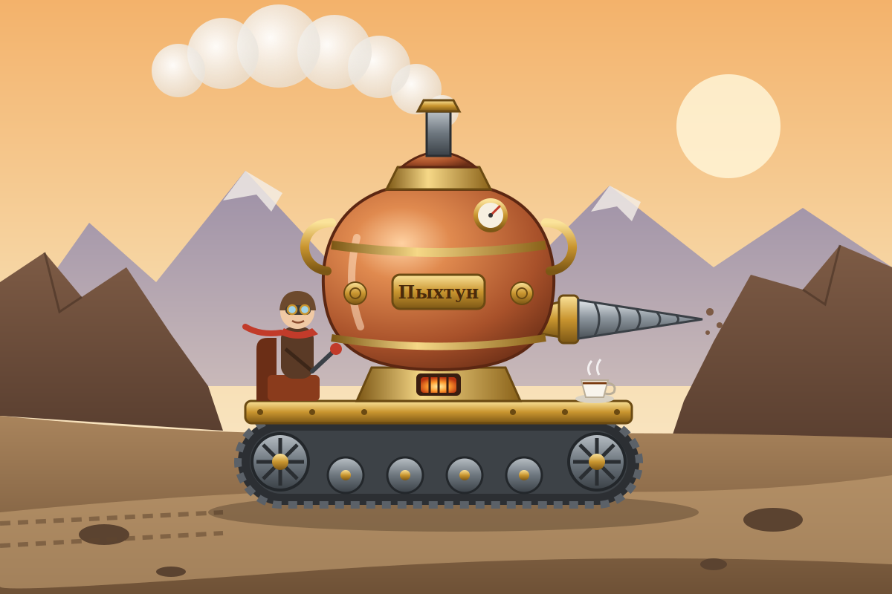

# ТЗ: Гусеничный самовар «Пыхтун»

Автор: Игнатьева Мария Сергеевна
Стихия: земля
Проект: Гусеничный самовар «Пыхтун»
Репозиторий: https://github.com/heartinice/samovar
Дата заморозки: —
Версия: 0.1

---

## 1. Назначение

Гусеничный самовар «Пыхтун» — паровое наземное средство передвижения: огромный медный самовар на двух гусеницах с буровым носиком. Топка, которая кипятит воду для чая, одновременно даёт пар для движения, поэтому каждая поездка и каждая чашка чая расходуют один и тот же запас пара. Предназначен для перевозки одного машиниста по бездорожью, песку и подземным тоннелям; умеет переходить вброд мелкие ручьи, но не плавает и не летает.



*Иллюстрация: машинист ведёт «Пыхтуна» через Каменный перевал — гусеничный ход, медный котёл-корпус, бур-носик, топка и обязательная чашка чая.*

---

## 2. Стихия и конструкционный элемент

**Стихия:** земля.

**Конструкционный элемент:** не менее одного движителя, обеспечивающего сцепление с грунтом.

**Как реализован элемент:**

> Две гусеницы (атрибут `track_width_m` — ширина гусеничного хода, атрибут `tracks_ok` — исправность). Ширина гусениц определяет, какие препятствия самовар может преодолеть: широкий ход перекрывает канаву, но не помещается на узкий мост. При порванных гусеницах самовар не может ни ехать, ни преодолевать препятствия, пока их не починят.

**Ограничения стихии:**

- Основной режим — движение по земле: дорога, песок, подземные тоннели.
- В воду заходит только вброд, не дальше 0.5 км за одно перемещение, иначе тонет.
- Летать не может.

---

## 3. Публичный интерфейс

Всё, что не описано в этом разделе, — внутренняя реализация, её можно менять.

### 3.1. Класс

Имя класса: `TrackedSamovar`
Модуль: `tracked_samovar/tracked_samovar.py` (корень репозитория). В этом же модуле объявлены все исключения из раздела 6.

### 3.2. Конструктор

```python
def __init__(
    self,
    name: str,
    mass_kg: float,
    track_width_m: float,
    max_speed_kmh: float,
    steam: float = 100.0,
) -> None:
```

| Параметр | Тип | Единица | Допустимый диапазон | Значение по умолчанию |
|---|---|---|---|---|
| `name` | str | — | строка, содержащая хотя бы один непробельный символ | — |
| `mass_kg` | float | кг | > 0 | — |
| `track_width_m` | float | м | > 0 | — |
| `max_speed_kmh` | float | км/ч | > 0 | — |
| `steam` | float | условные единицы пара | 0 … 100 (включительно) | 100.0 |

Числовые параметры принимают `int` и `float`; значения типа `bool` числом **не считаются**.

Начальное состояние после создания: `position_km == 0.0`, `terrain == "ground"`, `tracks_ok == True`, `cups_served == 0`.

**Исключения конструктора:**

- `TypeError` — `name` не `str`; любой числовой параметр не `int`/`float` или является `bool`.
- `ValueError` — `name` пустой или состоит только из пробельных символов.
- `ValueError` — `mass_kg`, `track_width_m` или `max_speed_kmh` ≤ 0.
- `ValueError` — `steam` вне диапазона 0…100.

Порядок проверки между разными параметрами не фиксируется: в каждом вызове тесты передают не более одного некорректного параметра.

### 3.3. Атрибуты

Все публичные атрибуты доступны **только для чтения**: попытка присвоить значение вызывает `AttributeError`. Числовые атрибуты хранятся как `float` и сравниваются в тестах с точностью до 7 знаков после запятой.

| Атрибут | Тип | Единица | Доступ | Описание |
|---|---|---|---|---|
| `name` | str | — | чтение | Имя самовара |
| `mass_kg` | float | кг | чтение | Масса |
| `track_width_m` | float | м | чтение | Ширина гусеничного хода |
| `max_speed_kmh` | float | км/ч | чтение | Максимальная скорость по дороге |
| `steam` | float | ед. пара | чтение | Текущий запас пара, 0…100 |
| `position_km` | float | км | чтение | Суммарное пройденное расстояние |
| `terrain` | str | — | чтение | Среда, в которой самовар находится сейчас (среда последнего успешного `move`; изначально `"ground"`) |
| `tracks_ok` | bool | — | чтение | Исправны ли гусеницы |
| `cups_served` | int | чашки | чтение | Сколько чашек чая заварено за всё время |

### 3.4. Методы

#### 3.4.1. move

```python
def move(self, distance_km: float, terrain: str) -> float:
```

**Назначение:** перемещает самовар на заданное расстояние в заданной среде.

**Параметры:**

- `distance_km` — расстояние в км, `int` или `float` (не `bool`), > 0.
- `terrain` — среда: `"ground"`, `"sand"`, `"underground"`, `"water"`, `"air"`.

**Возвращает:** время перемещения в часах (`float`) = `distance_km / скорость`.

**Изменяет:** `position_km` (+= `distance_km`), `steam` (−= расход), `terrain` (= переданная среда).

**Правила для сред:**

| terrain | Скорость | Расход пара на 1 км | Ограничение |
|---|---|---|---|
| `"ground"` (дорога) | `max_speed_kmh` | 1 | — |
| `"sand"` (песок) | `max_speed_kmh * 0.5` | 2 | — |
| `"underground"` (бурение) | `max_speed_kmh * 0.25` | 4 | — |
| `"water"` (брод) | `max_speed_kmh * 0.25` | 3 | `distance_km ≤ 0.5` |
| `"air"` | — | — | движение невозможно |

**Порядок проверок** (выбрасывается первое сработавшее исключение):

1. `TypeError` — `distance_km` не число (или `bool`); `terrain` не `str`.
2. `ValueError` — `distance_km ≤ 0`; `terrain` не из списка выше.
3. `SamovarCannotFly` — `terrain == "air"`.
4. `SamovarWouldSink` — `terrain == "water"` и `distance_km > 0.5`.
5. `SamovarTracksBroken` — `tracks_ok == False`.
6. `SamovarNoSteam` — расход больше текущего `steam`.

Если пара хватает **ровно** на перемещение, `move` выполняется успешно и `steam` становится `0.0`.
При любом исключении состояние самовара не меняется.

#### 3.4.2. calculate_steam

```python
def calculate_steam(self, distance_km: float, terrain: str) -> float:
```

**Назначение:** рассчитывает расход пара на перемещение без изменения состояния.

**Параметры:** те же, что у `move`.

**Возвращает:** расход пара (`float`) по таблице из 3.4.1.

**Исключения:** проверки 1–4 из 3.4.1 (`TypeError`, `ValueError`, `SamovarCannotFly`, `SamovarWouldSink`). Проверки 5–6 не выполняются: расчёт работает при порванных гусеницах и при нулевом паре.

**Изменяет:** ничего.

#### 3.4.3. can_overcome

```python
def can_overcome(self, obstacle: str) -> bool:
```

**Назначение:** проверяет, сможет ли самовар преодолеть препятствие в текущем состоянии.

**Параметры:** `obstacle` — `"ditch"` (канава), `"boulder"` (валун), `"narrow_bridge"` (узкий мост), `"wall"` (отвесная стена).

**Возвращает:** `True`, если вызов `overcome(obstacle)` в текущем состоянии завершился бы успешно; иначе `False`.

**Исключения:** `TypeError` — `obstacle` не `str`; `ValueError` — `obstacle` не из списка. Доменные исключения **не** выбрасываются — вместо них возвращается `False`.

**Изменяет:** ничего.

#### 3.4.4. overcome

```python
def overcome(self, obstacle: str) -> None:
```

**Назначение:** преодолевает препятствие, расходуя пар.

**Правила:**

| obstacle | Условие по конструкции | Расход пара |
|---|---|---|
| `"ditch"` | `track_width_m ≥ 1.0` (гусеницы перекрывают канаву) | 5 |
| `"boulder"` | — | 10 |
| `"narrow_bridge"` | `track_width_m ≤ 1.5` и `mass_kg ≤ 1000` | 2 |
| `"wall"` | никогда | — |

**Возвращает:** `None`.

**Изменяет:** только `steam`. `position_km` и `terrain` не меняются (препятствие находится в точке).

**Порядок проверок:**

1. `TypeError` — `obstacle` не `str`.
2. `ValueError` — `obstacle` не из списка.
3. `SamovarStuck` — `obstacle == "wall"`.
4. `SamovarTracksBroken` — `tracks_ok == False`.
5. `SamovarStuck` — `"ditch"` и `track_width_m < 1.0`.
6. `SamovarTooWide` — `"narrow_bridge"` и `track_width_m > 1.5`.
7. `SamovarTooHeavy` — `"narrow_bridge"` и `mass_kg > 1000`.
8. `SamovarNoSteam` — расход больше текущего `steam`.

При любом исключении состояние не меняется.

#### 3.4.5. damage_tracks

```python
def damage_tracks(self) -> None:
```

**Назначение:** событие среды (камнепад, острые скалы) — рвёт гусеницы.
**Изменяет:** `tracks_ok = False`. Повторный вызов допустим и ничего не меняет.
**Исключения:** нет.

#### 3.4.6. repair_tracks

```python
def repair_tracks(self) -> None:
```

**Назначение:** машинист чинит гусеницы, затрачивая 20 единиц пара.
**Правила:**

- Если `tracks_ok == True` — ничего не происходит, пар не тратится.
- Иначе, если `steam < 20` — `SamovarNoSteam`, состояние не меняется.
- Иначе `steam −= 20`, `tracks_ok = True`.

#### 3.4.7. brew_tea

```python
def brew_tea(self, cups: int) -> float:
```

**Назначение:** заваривает чай — главная функция самовара.

**Параметры:** `cups` — число чашек, `int` (не `bool`), от 1 до 10 включительно.

**Возвращает:** израсходованный пар (`float`) = `cups * 3`.

**Изменяет:** `steam` (−= `cups * 3`), `cups_served` (+= `cups`).

**Исключения:** `TypeError` — `cups` не `int` или `bool`; `ValueError` — `cups` вне 1…10; `SamovarNoSteam` — `cups * 3 > steam`.

Заваривать чай можно в любой среде и при порванных гусеницах.

#### 3.4.8. refuel

```python
def refuel(self, amount: float) -> None:
```

**Назначение:** машинист подбрасывает в топку шишки — пополняет пар.
**Параметры:** `amount` — `int` или `float` (не `bool`), > 0.
**Изменяет:** `steam = min(100, steam + amount)`.
**Исключения:** `TypeError` — `amount` не число или `bool`; `ValueError` — `amount ≤ 0`.
Работает в любой среде и при порванных гусеницах.

#### 3.4.9. get_status

```python
def get_status(self) -> dict:
```

**Назначение:** возвращает снимок состояния.

**Возвращает:** новый словарь ровно с ключами:

- `"name"` — str,
- `"steam"` — float,
- `"position_km"` — float,
- `"terrain"` — str,
- `"tracks_ok"` — bool,
- `"cups_served"` — int,
- `"track_width_m"` — float.

Изменение возвращённого словаря не влияет на самовар.

---

## 4. Сценарии

Во всех сценариях, если не сказано иное, используется эталонный самовар «Пыхтун»: `mass_kg = 800`, `track_width_m = 1.2`, `max_speed_kmh = 20`, `steam = 100`.

### 4.1. Модульные сценарии (AAA)

**Сценарий 1. Обычная поездка по дороге**
Дано: «Пыхтун» со `steam = 100`.
Когда: `move(10, "ground")`.
Тогда: возвращается `0.5` (10 / 20); `position_km == 10`; `steam == 90` (100 − 10 × 1); `terrain == "ground"`.

**Сценарий 2. Нехватка пара**
Дано: `steam = 20`.
Когда: `move(30, "ground")`.
Тогда: `SamovarNoSteam`; `steam == 20`, `position_km == 0`.

**Сценарий 3. Канава**
Дано: «Пыхтун» с гусеницами 1.2 м и `steam = 100`.
Когда: `can_overcome("ditch")`, затем `overcome("ditch")`.
Тогда: `True`; `steam == 95`; `position_km` не изменился.

**Сценарий 4. Заправка шишками**
Дано: `steam = 20`.
Когда: `refuel(50)`.
Тогда: `steam == 70`.

### 4.2. Функциональные (сценарные) тесты (GWT)

Сценарии выполняются через тестовую обёртку **«Машинист»**, которая управляет самоваром на доменном языке, и объект среды **«Камнепад»**:

| Метод «Машиниста» | Вызов самовара |
|---|---|
| `ехать(km)` | `move(km, "ground")` |
| `ехать_по_песку(km)` | `move(km, "sand")` |
| `бурить(km)` | `move(km, "underground")` |
| `вброд(km)` | `move(km, "water")` |
| `взлететь(km=1)` | `move(km, "air")` |
| `прикинуть(km, terrain)` | `calculate_steam(km, terrain)` |
| `может(obstacle)` | `can_overcome(obstacle)` |
| `перескочить_канаву()` / `столкнуть_валун()` / `переехать_мост()` / `штурмовать_стену()` | `overcome("ditch" / "boulder" / "narrow_bridge" / "wall")` |
| `заварить_чай(n)` | `brew_tea(n)` |
| `подбросить_шишек(x)` | `refuel(x)` |
| `починить_гусеницы()` | `repair_tracks()` |
| `доложить()` | `get_status()` |
| `Камнепад().обрушиться_на(samovar)` | `damage_tracks()` |

#### 4.2.1. Сценарий: Чаепитие на Каменном перевале

**Given:** «Пыхтун»: 800 кг, гусеницы 1.2 м, 20 км/ч, пар 100
**And:** самовар стоит на дороге, `position_km == 0`
**When:** машинист едет 10 км по дороге
**Then:** время 0.5 ч
**And:** пар 90, пройдено 10 км
**When:** машинист едет 5 км по песку
**Then:** скорость падает вдвое, время 0.5 ч
**And:** пар 80, среда — песок
**When:** машинист проверяет канаву и перескакивает её
**Then:** проверка даёт `True`, пар 75
**When:** машинист сталкивает валун
**Then:** пар 65
**When:** машинист заваривает 5 чашек чая
**Then:** израсходовано 15 пара, пар 50, заварено 5 чашек
**When:** машинист штурмует отвесную стену
**Then:** проверка даёт `False`, поднимается `SamovarStuck`
**And:** пар остаётся 50
**When:** машинист переходит ручей вброд 0.5 км
**Then:** время 0.1 ч (скорость 5 км/ч)
**And:** итоговое состояние: `position_km == 15.5`, `steam == 48.5`, `terrain == "water"`, `cups_served == 5`, `tracks_ok == True`

#### 4.2.2. Сценарий: Камнепад в Медной шахте

**Given:** «Пыхтун» с паром 60 у входа в шахту
**When:** машинист бурит 5 км под землёй
**Then:** время 1 ч (скорость 5 км/ч), пар 40, среда — под землёй
**When:** на самовар обрушивается камнепад
**Then:** гусеницы порваны
**When:** машинист пытается бурить ещё 1 км
**Then:** поднимается `SamovarTracksBroken`, позиция остаётся 5 км
**When:** машинист пытается столкнуть валун
**Then:** проверка даёт `False`, поднимается `SamovarTracksBroken`
**When:** в ожидании ремонта машинист заваривает 2 чашки
**Then:** пар 34
**When:** машинист чинит гусеницы
**Then:** гусеницы исправны, пар 14
**When:** машинист пытается бурить ещё 5 км (нужно 20 пара)
**Then:** поднимается `SamovarNoSteam`, пар 14, позиция 5 км
**When:** машинист прикидывает расход на 3.5 км под землёй и бурит их
**Then:** прикидка даёт 14, время 0.7 ч, пар ровно 0, позиция 8.5 км
**When:** машинист хочет заварить ещё 1 чашку
**Then:** поднимается `SamovarNoSteam`
**When:** машинист подбрасывает 30 единиц шишек и выезжает на поверхность 2 км по дороге
**Then:** итоговое состояние: `position_km == 10.5`, `steam == 28`, `terrain == "ground"`, `tracks_ok == True`, `cups_served == 2`

#### 4.2.3. Сценарий: Переправа через Гнилое болото

**Given:** тяжёлый самовар «Бульбуль»: 1500 кг, гусеницы 1.4 м, 30 км/ч, пар 50
**When:** машинист едет 6 км по дороге
**Then:** время 0.2 ч, пар 44
**When:** машинист пытается переехать узкий мост
**Then:** проверка даёт `False`, поднимается `SamovarTooHeavy`, пар 44
**When:** машинист прикидывает брод на 2 км, а потом всё равно лезет в воду на 2 км
**Then:** оба раза поднимается `SamovarWouldSink`
**And:** самовар на берегу: позиция 6 км, среда — дорога
**When:** машинист переходит вброд мелкое место 0.5 км
**Then:** время 0.5 / 7.5 ч, пар 42.5, среда — вода
**When:** машинист в отчаянии пытается взлететь
**Then:** поднимается `SamovarCannotFly`, самовар всё ещё в воде
**When:** машинист перескакивает канаву на выезде
**Then:** проверка даёт `True`, пар 37.5
**When:** машинист едет 3 км по песку
**Then:** время 0.2 ч
**And:** итоговое состояние: `name == "Бульбуль"`, `position_km == 9.5`, `steam == 31.5`, `terrain == "sand"`

#### 4.2.4. Сценарий: Свисток и Совиный овраг

**Given:** лёгкий самовар «Свисток»: 400 кг, гусеницы 0.9 м, 40 км/ч, пар 30
**When:** машинист едет 10 км по дороге
**Then:** время 0.25 ч, пар 20
**When:** машинист пытается перескочить канаву
**Then:** проверка даёт `False` (гусеницы уже 1 м), поднимается `SamovarStuck`, пар 20
**When:** машинист объезжает канаву по узкому мосту
**Then:** проверка даёт `True`, пар 18
**When:** машинист отмечает переправу шестью чашками чая
**Then:** израсходовано 18 пара, пар 0, заварено 6 чашек
**When:** машинист пытается проехать ещё 1 км
**Then:** поднимается `SamovarNoSteam`, позиция 10 км
**When:** машинист подбрасывает целый мешок шишек (1000)
**Then:** пар 100 — не больше
**When:** машинист едет 20 км по песку
**Then:** время 1 ч
**And:** итоговое состояние: `position_km == 30`, `steam == 60`, `terrain == "sand"`, `cups_served == 6`

### 4.3. Test Case Specification

Таблица тест-кейсов — в файле [`TEST_CASES.md`](TEST_CASES.md). Каждый тест-метод содержит ID своего TC в имени и в docstring.

---

## 5. Граничные случаи

- `move(0, "ground")` → `ValueError`; `move(True, "ground")` → `TypeError` (`bool` — не число).
- `move(0.5, "water")` выполняется; `move(0.5000001, "water")` → `SamovarWouldSink`.
- Пара ровно на поездку: `steam = 20`, `move(20, "ground")` → успех, `steam == 0.0`.
- `refuel(1000)` при `steam = 50` → `steam == 100`, не больше.
- Конструктор принимает `steam = 0` и `steam = 100`; `steam = 100.1` → `ValueError`.
- `brew_tea(10)` выполняется; `brew_tea(11)` → `ValueError`; `brew_tea(True)` → `TypeError`.
- Габариты на границе: `track_width_m = 1.0` перескакивает канаву, `0.99` — нет; `track_width_m = 1.5` и `mass_kg = 1000` проходят узкий мост, `1.51` и `1000.1` — нет.
- `repair_tracks()` при `steam = 19` → `SamovarNoSteam`, гусеницы остаются порванными.

---

## 6. Исключения

Если ошибка связана с типом или значением параметра — стандартное исключение (`TypeError`, `ValueError`). Если с состоянием самовара или правилами домена — доменное.

### 6.1. Иерархия

```
RuntimeError
└── CrazyVehicleError
    └── SamovarError
        ├── SamovarCannotFly
        ├── SamovarWouldSink
        ├── SamovarTracksBroken
        ├── SamovarNoSteam
        ├── SamovarStuck
        ├── SamovarTooWide
        └── SamovarTooHeavy
```

`CrazyVehicleError` наследуется от `RuntimeError`, чтобы код, ожидающий базовое `RuntimeError`, продолжал работать.

### 6.2. Таблица

| Ситуация | Исключение | Сообщение |
|---|---|---|
| Строковый параметр (`name`, `terrain`, `obstacle`) не `str` | `TypeError` | `"<param> must be a string"` |
| Числовой параметр не `int`/`float` или `bool`; `cups` не `int` | `TypeError` | `"<param> must be a number"` |
| Пустое имя | `ValueError` | `"name must not be empty"` |
| `mass_kg`, `track_width_m`, `max_speed_kmh` ≤ 0 | `ValueError` | `"<param> must be positive"` |
| `steam` вне 0…100 в конструкторе | `ValueError` | `"steam must be between 0 and 100"` |
| `distance_km ≤ 0` | `ValueError` | `"distance_km must be positive"` |
| Неизвестная среда | `ValueError` | `"unknown terrain: <terrain>"` |
| Неизвестное препятствие | `ValueError` | `"unknown obstacle: <obstacle>"` |
| `cups` вне 1…10 | `ValueError` | `"cups must be between 1 and 10"` |
| `amount ≤ 0` | `ValueError` | `"amount must be positive"` |
| Попытка двигаться по воздуху | `SamovarCannotFly` | `"samovar cannot fly"` |
| Брод длиннее 0.5 км | `SamovarWouldSink` | `"water crossing longer than 0.5 km: <distance>"` |
| Движение или препятствие при порванных гусеницах | `SamovarTracksBroken` | `"tracks are broken"` |
| Не хватает пара (move, overcome, repair_tracks, brew_tea) | `SamovarNoSteam` | `"not enough steam: required <X>, have <Y>"` |
| Стена; канава при `track_width_m < 1.0` | `SamovarStuck` | `"samovar is stuck at <obstacle>"` |
| Узкий мост при `track_width_m > 1.5` | `SamovarTooWide` | `"tracks too wide for narrow bridge"` |
| Узкий мост при `mass_kg > 1000` | `SamovarTooHeavy` | `"samovar too heavy for narrow bridge"` |

Тесты проверяют **тип** исключения; текст сообщения — рекомендованный, тестами не проверяется.

---

## 7. Что вне рамок

- Самовар не взаимодействует с другими транспортами и не перевозит грузы.
- Нет графики, анимации и визуализации.
- Нет сохранения состояния между запусками, файлов и внешних API.
- Не моделируются координаты, направление, повороты и движение назад: `position_km` — суммарный пробег.
- Не моделируются температура, давление в котле, количество воды и сорт чая: пар — единый условный запас.
- Нет износа гусениц и частичных поломок: гусеницы либо исправны, либо порваны.
- Нет отдельной модели машиниста (масса, усталость, жажда); «Машинист» существует только в тестах как обёртка.
- Погодные условия не влияют на движение.

---

## 8. Трассируемость «требование → тест»

Все тесты находятся в `tests/test_tracked_samovar.py`.

| Требование | Раздел ТЗ | Тест |
|---|---|---|
| Конструктор сохраняет параметры, задаёт начальное состояние, принимает steam 0 и 100 | 3.2, 3.3, 5 | `test_tc01_init_stores_parameters_and_initial_state` |
| Пустое имя / имя из пробелов запрещено | 3.2, 6.2 | `test_tc02_init_empty_name_raises` |
| Масса, ширина гусениц, скорость > 0 | 3.2, 6.2 | `test_tc03_init_nonpositive_dimensions_raise` |
| steam в конструкторе в пределах 0…100 | 3.2, 5, 6.2 | `test_tc04_init_steam_out_of_range_raises` |
| Неверные типы в конструкторе, bool — не число | 3.2, 6.2 | `test_tc05_init_wrong_types_raise` |
| Публичные атрибуты только для чтения | 3.3 | `test_tc06_public_attributes_are_read_only` |
| Скорость и расход пара по средам, обновление terrain и position_km | 3.4.1 | `test_tc07_move_by_terrain` |
| Некорректные аргументы move | 3.4.1, 5, 6.2 | `test_tc08_move_invalid_arguments_raise` |
| Самовар не летает и не переходит вброд более 0.5 км | 2, 3.4.1, 5 | `test_tc09_move_air_and_deep_water_raise` |
| Нехватка пара при движении | 3.4.1, 4.1 (сц. 2) | `test_tc10_move_not_enough_steam_raises` |
| Пар ровно на поездку → steam == 0 | 3.4.1, 5 | `test_tc11_move_spends_exactly_all_steam` |
| С порванными гусеницами ехать нельзя | 2, 3.4.1 | `test_tc12_move_with_broken_tracks_raises` |
| calculate_steam считает без изменения состояния и без проверок 5–6 | 3.4.2 | `test_tc13_calculate_steam` |
| Успешное преодоление препятствий, граничные габариты | 3.4.3, 3.4.4, 4.1 (сц. 3), 5 | `test_tc14_overcome_success` |
| Стена, узкие гусеницы, широкий/тяжёлый для моста | 3.4.3, 3.4.4, 5 | `test_tc15_overcome_geometry_failures` |
| Препятствие при нехватке пара или порванных гусеницах | 3.4.3, 3.4.4 | `test_tc16_overcome_state_failures` |
| Неизвестное препятствие / неверный тип | 3.4.3, 3.4.4, 6.2 | `test_tc17_unknown_obstacle_raises` |
| Поломка и ремонт гусениц | 3.4.5, 3.4.6, 5 | `test_tc18_damage_and_repair_tracks` |
| Заваривание чая | 3.4.7, 5 | `test_tc19_brew_tea` |
| Заправка не выше 100 | 3.4.8, 4.1 (сц. 4), 5 | `test_tc20_refuel` |
| Статус содержит все ключи и является снимком | 3.4.9 | `test_tc21_get_status` |
| Иерархия доменных исключений | 6.1 | `test_tc22_exception_hierarchy` |
| Сценарий «Чаепитие на Каменном перевале» | 4.2.1 | `test_tc23_tea_party_on_stone_pass` |
| Сценарий «Камнепад в Медной шахте» | 4.2.2 | `test_tc24_rockfall_in_copper_mine` |
| Сценарий «Переправа через Гнилое болото» | 4.2.3 | `test_tc25_crossing_rotten_swamp` |
| Сценарий «Свисток и Совиный овраг» | 4.2.4 | `test_tc26_whistle_and_owl_ravine` |

Сценарий 1 из 4.1 покрывается `test_tc07_move_by_terrain` (строка `"ground"`).

---

## 9. Открытые вопросы

- Должен ли `overcome` менять `terrain` (например, после моста самовар снова на `"ground"`)? Сейчас — нет.
- Нужно ли запрещать `brew_tea` в воде, где топку может залить? Сейчас разрешено везде.
- Должен ли ремонт гусениц быть невозможен в воде или под землёй? Сейчас разрешён везде.
- Стоит ли учитывать массу при расходе пара (тяжёлый самовар тратит больше)? Сейчас масса влияет только на узкий мост.
- Нужен ли метод «выпустить пар» или автоматический сброс давления при `steam == 100`?
- Допустимы ли очень маленькие дистанции (например, `1e-12` км), или нужен минимальный шаг?
